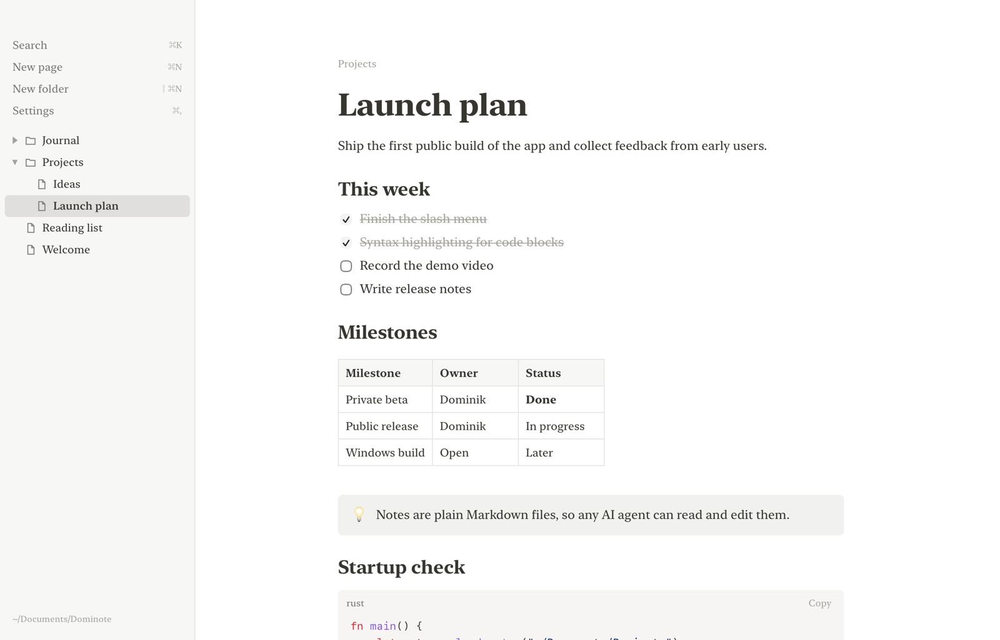
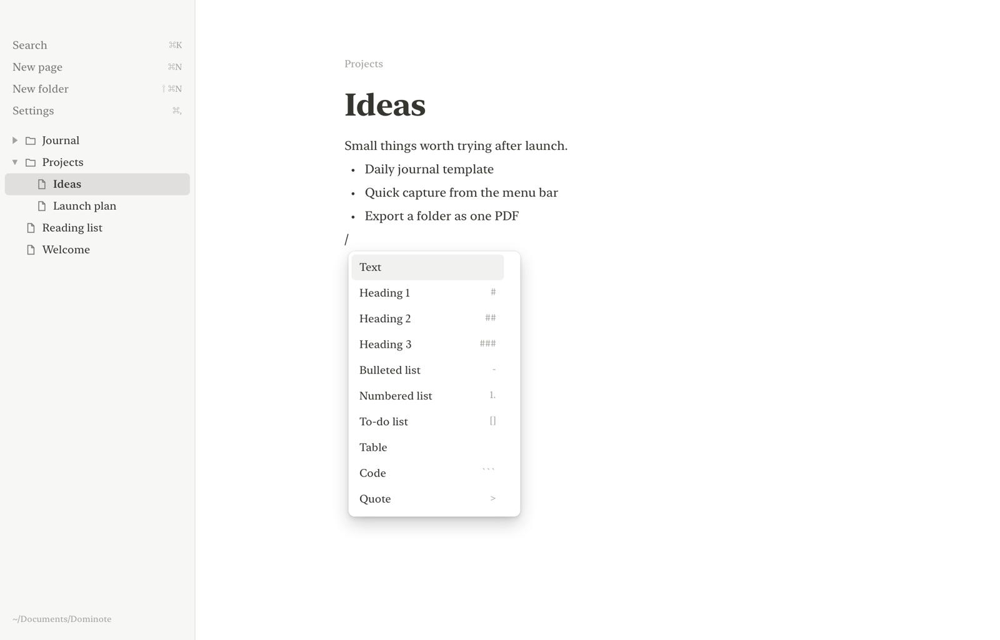
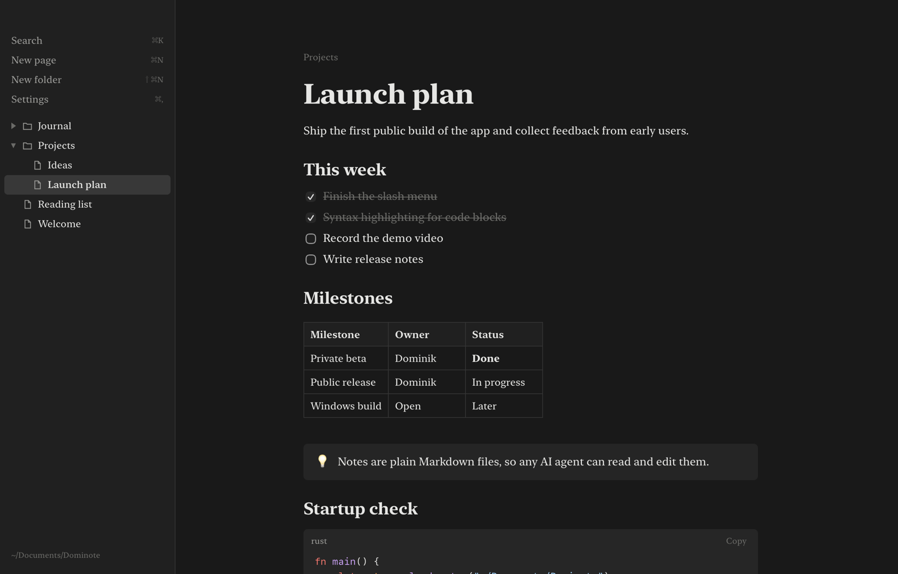

<p align="center">
  
</p>

<h1 align="center">Dominote</h1>

<p align="center">
  A fast, open source note-taking app for macOS, built with Rust and Tauri.<br>
  Your notes are plain Markdown files in a folder you own.
</p>

<p align="center">
  <a href="https://github.com/dominik-hurcik/dominote-mac/releases/latest"></a>
  
  
  <a href="LICENSE"></a>
</p>

<p align="center">
  <a href="#install">Install</a> ·
  <a href="#features">Features</a> ·
  <a href="#keyboard-shortcuts">Shortcuts</a> ·
  <a href="#use-it-with-ai-agents">AI agents</a> ·
  <a href="#build-from-source">Build from source</a>
</p>

<p align="center">
  
</p>

## Why Dominote

Most note apps ship a full browser engine, sync servers and a database. Dominote doesn't.

- **4 MB app.** Tauri uses the WebKit engine already in macOS, so there is no bundled Chromium.
- **Rust for the app, plain JavaScript for the editor.** Rust runs the native window and all file access: saving, renaming, moving, Trash and search. The editor is plain JavaScript and CSS with no framework, about 1,600 lines.
- **No database, no account, no network.** Every page is a `.md` file in `~/Documents/Dominote`. Folders in the sidebar are real folders on disk.
- **Your files stay readable.** Open them in any editor, put them in Git, or sync them with iCloud Drive or Dropbox.

## Features

- Type `/` for headings, bulleted, numbered and to-do lists, tables, code blocks, quotes, callouts and dividers.
- Markdown shortcuts as you type: `# `, `- `, `1. `, `[] `, `> `, three backticks, `---`.
- Syntax highlighting for 37 languages, with automatic language detection.
- Paste formatted text from Claude, web pages and other apps. Tables, headings, lists and code keep their structure.
- Folders and pages in a sidebar. Drag to move, right-click to rename, deleted items go to the macOS Trash.
- Search across titles and page text with ⌘K.
- Drag across blocks to select several, then copy them as Markdown, cut or delete.
- Light and dark themes, and a choice of fonts for the menus, the page and code.
- Autosave on every change, written atomically so a crash can't corrupt a note.
- Undo and redo for every change on a page, including deleted blocks, table edits and changes made by an AI agent.
- Page history. Right-click a page and choose **Page history** to restore an older version. A copy is kept every 10 minutes while you edit, in `.dominote/history` inside your notes folder.

<table>
  <tr>
    <td></td>
    <td></td>
  </tr>
  <tr>
    <td align="center">Slash menu</td>
    <td align="center">Dark theme</td>
  </tr>
</table>

## Install

Dominote needs macOS 11 or later and runs on Apple Silicon and Intel Macs.

### Option 1: Install script (recommended)

Paste this into Terminal:

```sh
curl -fsSL https://raw.githubusercontent.com/dominik-hurcik/dominote-mac/main/install.sh | bash
```

The script downloads the latest release, copies `Dominote.app` into `/Applications` and opens it. Run the same command again to update. The script is [short enough to read](install.sh) before you run it.

### Option 2: Download the .dmg

1. Download `Dominote.dmg` from the [latest release](https://github.com/dominik-hurcik/dominote-mac/releases/latest).
2. Open it and drag Dominote into Applications.
3. Open Dominote. macOS will say it can't verify the developer.
4. Open **System Settings > Privacy & Security**, scroll down, and click **Open Anyway** next to the Dominote message.

You only do step 4 once. To skip it, run this in Terminal after step 2:

```sh
xattr -dr com.apple.quarantine /Applications/Dominote.app
```

macOS shows the warning because the app isn't signed with a paid Apple Developer ID. The install script avoids it because files downloaded with `curl` don't get the quarantine flag.

### Option 3: Build from source

See [Build from source](#build-from-source).

## Keyboard shortcuts

| Action | Shortcut |
| --- | --- |
| New page | ⌘N |
| New folder | ⇧⌘N |
| Search | ⌘K |
| Settings | ⌘, |
| Toggle sidebar | ⌘\ |
| Bold, italic, inline code | ⌘B, ⌘I, ⌘E |
| Strikethrough | ⇧⌘X |
| Indent or outdent a list item | Tab, ⇧Tab |
| Move a block up or down | ⇧⌘↑, ⇧⌘↓ |
| Undo, redo | ⌘Z, ⇧⌘Z |
| Select all blocks | ⌘A twice |
| Leave a code block or table | Esc or ⌘Enter |

## Use it with AI agents

Dominote has no plugin API because it doesn't need one. Point Claude Code, Codex, Cursor or any other agent at your notes folder:

```
~/Documents/Dominote
```

The agent reads and writes `.md` files with its normal file tools. Dominote checks the open page and the sidebar every 2 seconds, so the agent's edits show up while you watch. Right-click any page and choose **Copy path** to hand it a single file.

To keep notes somewhere else, such as an iCloud Drive folder, replace the notes folder with a link to it while Dominote is closed:

```sh
mv ~/Documents/Dominote ~/Library/Mobile\ Documents/com~apple~CloudDocs/Dominote
ln -s ~/Library/Mobile\ Documents/com~apple~CloudDocs/Dominote ~/Documents/Dominote
```

### File format

Pages are GitHub-flavored Markdown. The page title is the file name.

| Block | Markdown |
| --- | --- |
| Headings | `#`, `##`, `###` |
| Lists | `- item`, `1. item`, indented by 2 spaces per level |
| To-dos | `- [ ] open`, `- [x] done` |
| Quote | `> text` |
| Callout | `> [!NOTE]` followed by `> text` |
| Divider | `---` |
| Code | Fenced with three backticks and an optional language |
| Table | GitHub-style pipe table |
| Inline | `**bold**`, `*italic*`, `` `code` ``, `~~strike~~`, `[link](https://…)` |

## Build from source

You need [Rust](https://rustup.rs) and [Node.js](https://nodejs.org) (only for the Tauri build tool).

```sh
git clone https://github.com/dominik-hurcik/dominote-mac.git
cd dominote-mac
cargo run                                  # run in development
npx @tauri-apps/cli@2 build                # build Dominote.app and a .dmg
cp -R target/release/bundle/macos/Dominote.app /Applications/
```

An app you build yourself opens without any Gatekeeper warning.

### Project layout

```
src/main.rs     Rust backend: file tree, read, write, rename, move, trash, search
ui/app.js       Editor, sidebar, slash menu, search, settings
ui/md.js        Markdown parser and serializer
ui/style.css    Themes and layout
tests/          Markdown round-trip test
```

### Tests

```sh
cargo test
node tests/md.test.js
```

### Releases

Push a version tag and GitHub Actions builds a universal app and publishes the release:

```sh
git tag v0.1.0 && git push origin v0.1.0
```

## Contributing

Bug reports and pull requests are welcome. Dominote aims to stay small, so open an issue to discuss a larger feature before you build it.

## License

[MIT](LICENSE)
